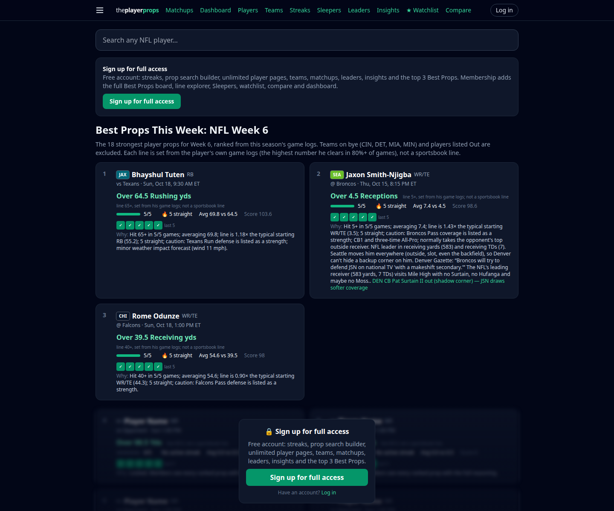
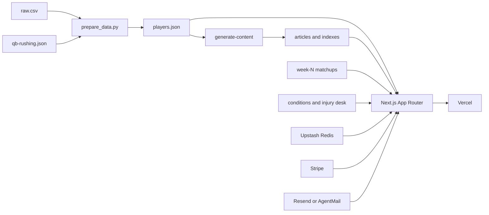

# ThePlayerProps

NFL player-prop research from 2026 season game logs: hit rates, streaks, matchups, and an injury desk.

[](https://www.typescriptlang.org/)
[](https://nextjs.org/)
[](https://betstats-nfl.vercel.app)
[](LICENSE)

This repository (`nfl-app`) is the [Next.js](https://nextjs.org/) app behind the live site. Each Best Props line is computed from that player's game log and rounded down to a clean number. The site is a research tool. Its footer states it is not affiliated with the NFL.



## Live demo

- App: [https://betstats-nfl.vercel.app](https://betstats-nfl.vercel.app)
- Canonical host served by that deployment: [https://theplayerprops.com](https://theplayerprops.com)

Signed-out visitors land on the public Week 6 preview (the screenshot above). Matchups, past results, and the injury desk are public. A free account adds the prop search builder, streaks, teams, leaders, insights, and full player logs (15 distinct players per ISO week, and 10 prop searches). Membership opens the rest of Best Props, Sleepers, the watchlist, compare, and the dashboard.

## Contents

- [Features](#features)
- [Quickstart](#quickstart)
- [Tech stack](#tech-stack)
- [Architecture](#architecture)
- [Data](#data)
- [How ranking works](#how-ranking-works)
- [Access](#access)
- [Project layout](#project-layout)
- [License](#license)

## Features

- **Best Props.** Ranks QB, RB, and WR/TE props for the current week file. Bye teams and players listed Out, Doubtful, or IR are left off. The page asks for 18 rows (`bestProps(18)` in `app/page.tsx`). The live Week 6 home says the board has 18.
- **Prop streaks and a search builder.** Fixed benchmark lines (for example 250 pass yards, 100 rush yards, 4 receptions) with hot and cold streaks, plus a builder for stat, position, over/under, and scope: full season, last N games, active streak, or hit rate. Popular searches are prebuilt in `lib/props.mjs`.
- **Player, team, and leader pages.** Game logs, season and last-5 averages, a chart, opponent splits, and leaderboards for passing, rushing, receiving, defense, kicking, and punting. Rushing leaderboards include quarterback rushing stored on passing rows.
- **Matchups.** `data/matchups/week-6.json` is the current week (highest week number wins). Every game has a kickoff. Network is filled when the file has one (11 of 14 Week 6 games). Strengths, weaknesses, and an edge are attached where the supplied report matched the official pairing. Past results are rebuilt from game-log scores at `/matchups/results`.
- **Injury desk and conditions.** Week 6 weather and injury rows, plus a separate injury-analysis file (status, severity, who benefits). Named players pick up an injury clause on Best Props and Sleepers.
- **Sleepers.** Players outside the top 15 at their position in both season total and per-game volume, with a short documented list of established stars excluded when the CSV understates them.
- **Member tools.** Line explorer on a player page, side-by-side compare, a watchlist (this device, and the account when signed in), and a dashboard: week/team/position/stat filters, hit-rate trend and bar charts (Recharts), a team-position heatmap, an injury list, and an active-streak table. Dashboard weeks are 1–5 of the game logs.
- **Generated insights.** `npm run content` writes streak roundups, top performances for the latest game date, and matchup breakdowns into `data/articles.json`.
- **Public prop pages and accounts.** `/props/[slug]` is a short, indexable summary. Sign-up, password reset, Stripe checkout, promo access, and an admin user list are in the app. A web app manifest and a mobile bottom nav are included.

## Quickstart

```bash
npm install
npm run dev
```

Open [http://localhost:3000](http://localhost:3000). Committed JSON is enough for the public pages. Accounts stay off until the Redis and `NEXTAUTH_SECRET` variables below are set; sign-up then returns “Accounts are not configured yet on this deployment.”

| Command | What it does |
| --- | --- |
| `npm run dev` | Next.js dev server |
| `npm test` | `node:test` for the dashboard, injury blurbs, and “targets are not a prop” |
| `npm run content` | Regenerates `data/articles.json`, `public/search.json`, and `public/pindex.json` from `data/players.json` |
| `npm run build` | Runs `npm run content`, then `next build` |
| `npm start` | Serves the production build |
| `npm run prepare-data` | `python3 scripts/prepare_data.py`. Needs `data/raw.csv` (gitignored) and Python 3 with pandas. Rewrites `data/players.json` |

The refresh workflow (`.github/workflows/refresh-content.yml`) runs daily at 11:00 UTC, and on manual dispatch. It uses Node 24, runs `prepare_data.py` without failing the job when the CSV is absent, regenerates content, and POSTs the `VERCEL_DEPLOY_HOOK` secret.

Optional QB rushing refresh, only when you have `data/raw.csv`:

```bash
python3 scripts/fetch_qb_rushing.py
```

That script reads ESPN’s public gamelog, waits 1.5 seconds between players, and keeps a game only when ESPN carries match the CSV carries. `prepare_data.py` merges the result.

## Tech stack

Versions are the ones locked in `package-lock.json`.

| | |
| --- | --- |
| App | Next.js 14.2.35 (App Router), React 18.3.1, TypeScript 5.9.3 |
| UI | Tailwind CSS 3.4.19, Recharts 2.15.4 on the dashboard |
| Accounts | NextAuth 4.24.15 credentials, bcryptjs password hashes, Upstash Redis (`@upstash/redis`) |
| Billing | Stripe Checkout, Customer Portal, and webhooks via the Stripe REST API (no Stripe SDK) |
| Email | Resend when `RESEND_API_KEY` is set, otherwise AgentMail when both AgentMail variables are set |
| Hosting | Vercel, including `@vercel/analytics` |
| Data prep | Python 3, pandas, and the Node content script |
| Tests | Node’s built-in test runner (`npm test`) |

## Architecture



Request gating lives in `middleware.ts`. Ranking is pure functions in `lib/bestprops.ts`, `lib/streaks.mjs`, `lib/props.mjs`, and `lib/dashboard.mjs`, shared by the pages and the content script. The dashboard model is built on the server and drawn in the browser.

## Data

Counts below are from the files committed in this repo. They change when the CSV is regenerated.

| File | What is in it |
| --- | --- |
| `data/players.json` | 2,546 player records for the 2026 season, 1,475 of them with a game log, 5,988 game rows, 32 teams |
| Category mix among players with logs | Passing 62, rushing 100, receiving 368, defense 882, kicking 31, punting 32 |
| `data/articles.json` | 190 generated pages: 5 streak roundups, 6 performance recaps, 179 matchup breakdowns |
| `data/matchups/week-6.json` | 2026 Week 6, 14 games, byes CIN, DET, MIA, MIN. `schedule_source` is the NFL.com Week 6 schedule, checked 2026-10-14. Supplied matchup analysis is attached only where that pairing matched the official schedule |
| `data/week-6-conditions.json` | Weather and injuries, updated 2026-10-15. The weather note cites an Open-Meteo hourly forecast. Injury rows carry a `source_url` |
| `data/week-6-injury-analysis.json` | Injury desk for the same week, updated 2026-10-15 |
| `data/supplemental/qb-rushing.json` | ESPN gamelog rushing, merged only on a carry match |
| `data/raw.csv` | Source extract. Gitignored. Not required to run the app |

The CSV has no position column. A player’s role is the category that appears most often in his log, so wide receivers and tight ends are one group, WR/TE. Targets stay on the log and on season-average tables. They are excluded from prop pages, streaks, and Best Props.

<details>
<summary>Dropping in another week</summary>

Copy `data/matchups/week-6.json` to `data/matchups/week-N.json`. Fields the loader expects (`lib/matchups.ts`):

- `season`, `week`, `schedule_source`
- `byes`: team codes such as `cin`
- `games[]`: `away` and `home` as nicknames (`Seahawks`, `49ers`), `kickoff` as an ISO timestamp with offset, plus optional `network`, `venue`, `analysis`, and `away_strengths` / `away_weaknesses` / `home_strengths` / `home_weaknesses`

The highest week number becomes the home and Matchups view. Game URLs look like `/matchups/seahawks-at-broncos-2026-week-6`.

Conditions: `data/week-N-conditions.json` (the loader falls back to `data/feeds/week-N-conditions.json`). Shape is documented in `data/feeds/README.md`. Team code `WAS` is accepted for Washington.

Injury desk: `data/week-N-injury-analysis.json`. The injuries page reads it through `lib/injuryAnalysis.ts`.

`data/matchups/raw-week-6-supplied.json` is the original supplied matchup file. `week-6.json` keeps the NFL.com schedule.

</details>

## How ranking works

<details>
<summary>Best Props, Sleepers, and streak benchmarks</summary>

**Best Props** (`lib/bestprops.ts`). For each QB, RB, and WR/TE on a team that plays this week, with at least 3 games at that stat:

- Take the highest line cleared in at least 80% of games, rounded down (yards use steps of 5). A 70% line replaces it when that line is at least 10% higher and at least as close to the player’s median.
- Floors: 10 yards, 2+ pass TD, 5+ receptions for WR/TE, 3+ receptions for RB. Defensive props are not listed.
- Drop a line under 0.6× the 75th-percentile per-game average for that role and stat (players with 3+ games). Cap difficulty at 1.5×.
- Score = `40 × hit rate + 30 × difficulty / 1.5 + 4 × current streak (max 5 games) + 2 × games played (max 6) + 10` when the prop is yardage.
- Keep one prop per player, at most 2 per team and 3 per game, and at least 3 each of QB, RB, and WR/TE when the pool allows.

The “Why” line can add a matchup strength or weakness from the week file, a non-indoor weather impact from the conditions feed, and an injury sentence from the desk.

**Sleepers** use a 75% hit rate, skip anyone in the top 15 at his position in season total or per-game volume (passing yards, rushing yards, or receiving yards), and also skip the names in `KNOWN_STARS`. Score weights hit rate, difficulty, last-3 trend versus the season average, and whether the opponent’s matching area is listed as a weakness. At most 2 per team. The page shows 15 (`sleepers(15)`).

**Streak benchmarks** (`lib/streaks.mjs`, `GROUPS`) are fixed lines, separate from the Best Props line. A hot streak is 3+ straight games clearing the line. A cold streak is 3+ straight misses, and only if the player has cleared that line once this season. The member “top 10” list is one streak per player at the highest clean line that streak cleared (`topValueStreaks`).

**Dashboard charts** use another set of fixed lines in `STATS_META`: 225 pass yards, 1 pass TD, 50 rush yards, 50 receiving yards, 4 receptions, 6 tackles, 1 field goal. Those charts cover weeks 1–5.

</details>

## Access

Enforced in `middleware.ts` and `lib/limits.ts`.

| Who | What they can open |
| --- | --- |
| Signed out | Public home preview (top 3 Best Props and 3 streaks), `/matchups`, `/injuries`, limited `/props/[slug]` pages, sign-up and password reset |
| Free account | Streaks, the prop search builder, teams, matchups, leaders, insights, and the top 3 Best Props. Player pages: 15 distinct players per ISO week. Prop search: 10 distinct queries, stored with no expiry |
| Member | The full Best Props list, line explorer, Sleepers, watchlist, compare, and dashboard. Membership is an `active` or `trialing` Stripe subscription, a promo flag on the user record, or a free-access account configured in code |

The subscribe button is labeled **$4.99/month**. `scripts/stripe-setup.mjs` creates a Stripe price of 499 USD cents per month. If `STRIPE_SECRET_KEY` or `STRIPE_PRICE_ID` is missing, checkout responds that payments are coming soon. A promo code can grant member access without a card. Billing management uses the Stripe Customer Portal.

The sitemap lists only URLs a signed-out visitor can load: home, matchups, past results, the injury desk, each game, and `/props/[slug]` for every player with a game log. `npm run build` pre-renders the first 200 of those prop pages; the rest are generated on demand.

<details>
<summary>Environment variables</summary>

Accounts need all three of these. The Redis names used by the Vercel Marketplace (`KV_REST_API_URL`, `KV_REST_API_TOKEN`) are accepted too.

| Variable | Role |
| --- | --- |
| `NEXTAUTH_SECRET` | Session secret. Generate with `openssl rand -base64 32` |
| `UPSTASH_REDIS_REST_URL` | Upstash Redis REST URL |
| `UPSTASH_REDIS_REST_TOKEN` | Upstash Redis REST token |
| `NEXTAUTH_URL` | Optional. Vercel fills this in when it is unset |
| `NEXT_PUBLIC_SITE_URL` | Canonical origin for sitemap, Open Graph, and JSON-LD. Falls back to `https://$VERCEL_PROJECT_PRODUCTION_URL`, then `http://localhost:3000` |
| `STRIPE_SECRET_KEY` | Stripe secret key |
| `STRIPE_PRICE_ID` | Price id from `scripts/stripe-setup.mjs` |
| `STRIPE_WEBHOOK_SECRET` | Webhook signing secret. Without it the webhook route returns 503 |
| `RESEND_API_KEY` | Resend. Optional `EMAIL_FROM`, for example `ThePlayerProps <noreply@theplayerprops.com>` |
| `AGENTMAIL_API_KEY` | AgentMail, used when Resend is unset |
| `AGENTMAIL_INBOX` | AgentMail inbox id or address |
| `VERCEL_DEPLOY_HOOK` | GitHub Actions secret. The workflow POSTs it after regenerating content |

Do not commit `.env*` files. They are gitignored.

</details>

## Project layout

```text
app/            App Router pages and route handlers
  api/          sign-up, NextAuth, favorites, streak search, Stripe, password reset
  players/      full player page (signed in)
  props/        public SEO summary
components/     board, dashboard, injury desk, nav
lib/            ranking, matchups, auth, membership, dashboard model
data/           committed JSON. raw.csv is local only
public/         icons, search.json, pindex.json
scripts/        CSV prep, content generation, tests, Stripe price setup
```

## License

[MIT](LICENSE). Copyright 2026 shotplates-design.

Stats in the product are informational. The app footer tells readers to bet responsibly, that they must be 21 or the legal age where they are, and to call or text [1-800-GAMBLER](tel:18004262537) or visit [ncpgambling.org](https://www.ncpgambling.org).
